# Saab TV — screen-by-screen workflows

These are flowcharts of the current app implementation, traced through the Compose screens, view models, repositories, and shell routing. They describe the existing route and data handoffs, not a proposed redesign. “Back to browse” means the selected Home/Movies/Series/OTT/Search/My Library destination remains selected; the shell restores that screen’s entry/focus target.

## Screen index

| Screen | Flowchart |
|---|---|
| App entry and profile selection | [1](#1-app-entry-and-profile-selection) |
| Shared navigation shell | [2](#2-shared-navigation-shell) |
| Home | [3](#3-home) |
| Movies | [4](#4-movies) |
| Series | [5](#5-series) |
| OTT | [6](#6-ott) |
| Search | [7](#7-search) |
| My Library | [8](#8-my-library) |
| View More / full catalog grid | [9](#9-view-more--full-catalog-grid) |
| Title details | [10](#10-title-details) |
| Cast / crew filmography | [11](#11-cast--crew-filmography) |
| Studio / company titles | [12](#12-studio--company-titles) |
| Resume and playback | [13](#13-resume-and-playback) |
| Settings overview and subsections | [14](#14-settings-overview-and-subsections) |
| Account and cloud sync | [15](#15-account-and-cloud-sync) |
| Title-card actions and user-state updates | [16](#16-title-card-actions-and-user-state-updates) |

## 1. App entry and profile selection

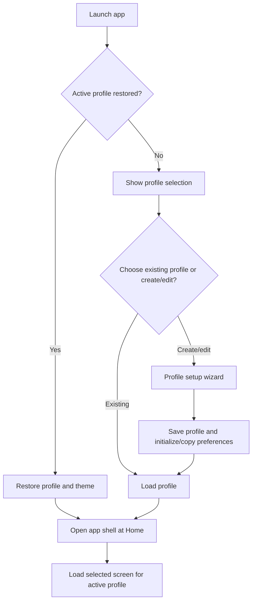

The current profile scopes preferences, watched state, library, and playback history. Profile selection and onboarding are in [`ProfileScreen.kt`](../app/src/main/java/com/saab/tv/ui/profiles/ProfileScreen.kt) and [`ProfileViewModel.kt`](../app/src/main/java/com/saab/tv/ui/profiles/ProfileViewModel.kt); profile restoration and the shell entry are coordinated in [`MainActivity.kt`](../app/src/main/java/com/saab/tv/MainActivity.kt#L860).

## 2. Shared navigation shell

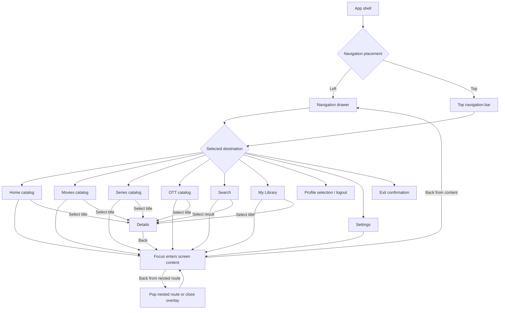

The shell has typed `Menu`, `Grid`, `Details`, `Resume`, and `Player` states. The selected tab is tracked separately, so returning from a title does not inherently select Profile. The left/top destinations and focus targets are defined in [`NavigationDestinations.kt`](../app/src/main/java/com/saab/tv/ui/navigation/NavigationDestinations.kt#L6); shell state and callbacks are in [`MainActivity.kt`](../app/src/main/java/com/saab/tv/MainActivity.kt#L874). Back actions use the prioritized dispatcher in [`BackNavigation.kt`](../app/src/main/java/com/saab/tv/ui/navigation/BackNavigation.kt#L15).

## 3. Home

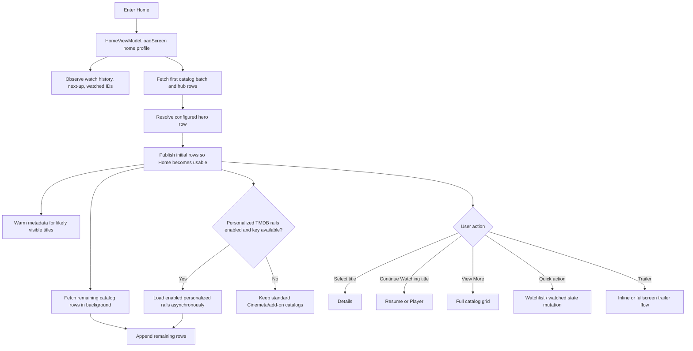

Home, Movies, and Series use the same [`HomeScreen.kt`](../app/src/main/java/com/saab/tv/ui/home/HomeScreen.kt#L160) surface and [`HomeViewModel.kt`](../app/src/main/java/com/saab/tv/ui/home/HomeViewModel.kt#L1297) loader. Home additionally observes continue-watching/next-up and can request enabled personalized TMDB rails; those are published after the initial catalog batch. “View More” switches the shell into `Grid` in [`MainActivity.kt`](../app/src/main/java/com/saab/tv/MainActivity.kt#L1193).

## 4. Movies

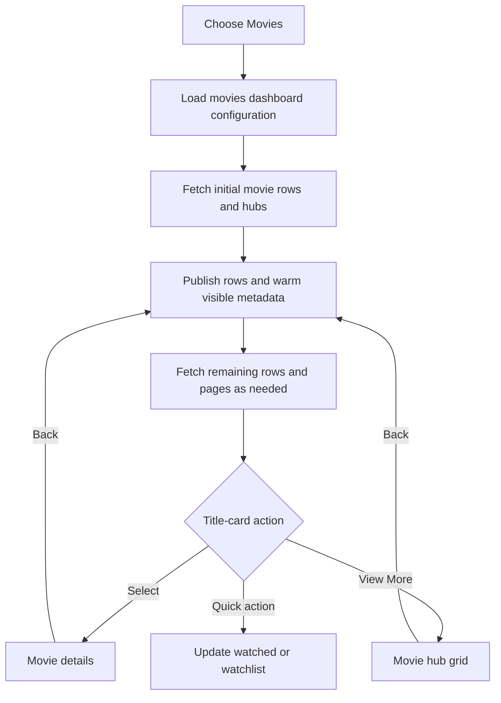

The tab is `DashboardTab.MOVIES`, rendered through the shared catalog surface. Movie card identity and metadata are canonicalized before presentation. Movie details resolve Cinemeta first for standard IMDb IDs, then use add-on fallback when needed; TMDB is an enrichment source rather than a prerequisite for opening the screen. See [`DashboardTab.kt`](../app/src/main/java/com/saab/tv/domain/DashboardTab.kt#L6), [`HomeViewModel.kt`](../app/src/main/java/com/saab/tv/ui/home/HomeViewModel.kt#L1297), and [`AddonRepository.kt`](../app/src/main/java/com/saab/tv/data/repository/AddonRepository.kt#L758).

## 5. Series

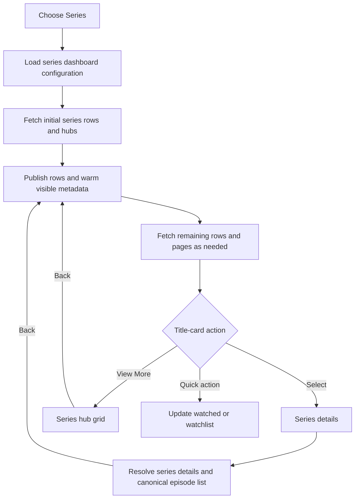

Series shares the catalog screen but its details/episode identity is series-aware. The repository treats Cinemeta as the canonical source for series details and episode numbering; alternate add-on episode numbering is not allowed to replace that list. See [`AddonRepository.kt`](../app/src/main/java/com/saab/tv/data/repository/AddonRepository.kt#L758) and [`DetailsViewModel.kt`](../app/src/main/java/com/saab/tv/ui/details/DetailsViewModel.kt#L218).

## 6. OTT

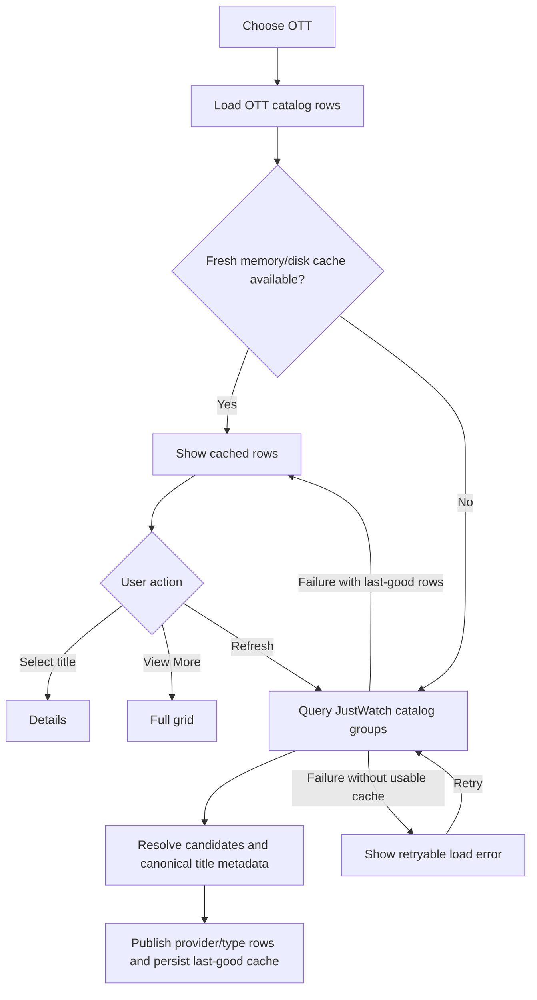

OTT rows come from [`OttCatalogRepository.kt`](../app/src/main/java/com/saab/tv/data/ott/OttCatalogRepository.kt#L109), with JustWatch groups for provider top titles, newly added titles, and overall trending across movies and series. Cinemeta resolves the underlying title; individual provider failures are isolated so one bad group need not discard all other rows. OTT loading is a separate path and does not run Home’s personalized TMDB rails.

## 7. Search

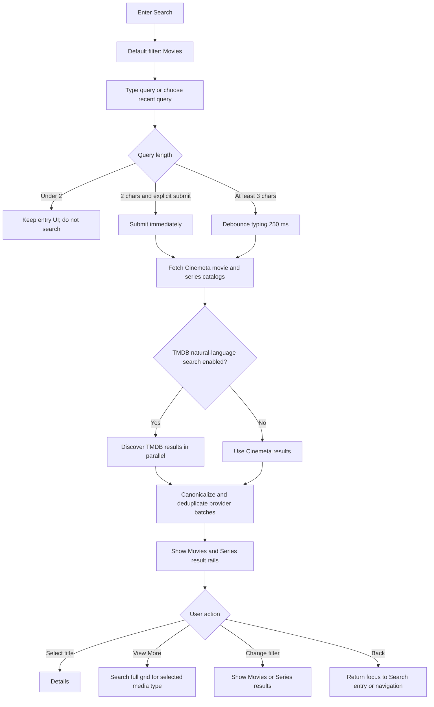

The search screen’s default filter is Movies, with Series as the other media filter. Cinemeta movie/series catalog searches run together; if TMDB search is enabled for the profile and a key is configured, natural-language discovery is run in parallel and results are canonicalized/deduplicated. Search state preserves recent searches and the last focused result for the active session. See [`SearchScreen.kt`](../app/src/main/java/com/saab/tv/ui/search/SearchScreen.kt#L48) and [`SearchViewModel.kt`](../app/src/main/java/com/saab/tv/ui/search/SearchViewModel.kt#L35).

## 8. My Library

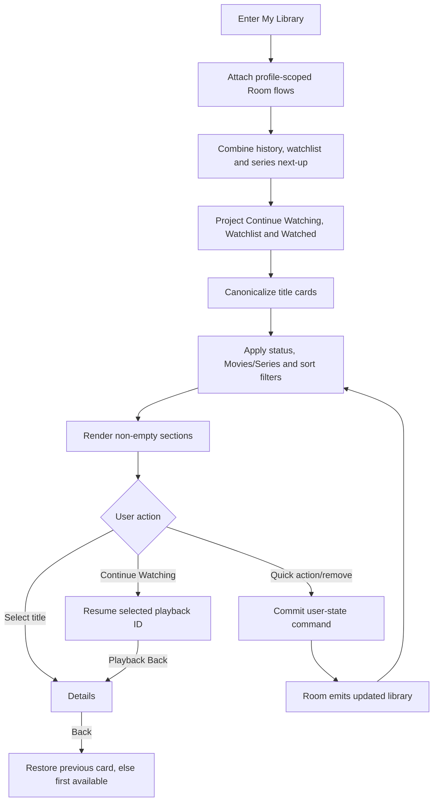

Room-backed watch history, watchlist, and series next-up are the Library inputs. The screen preserves a focused item/section and has a first-card fallback when the old item is gone. See [`WatchlistViewModel.kt`](../app/src/main/java/com/saab/tv/ui/watchlist/WatchlistViewModel.kt#L31), [`MyLibraryItems.kt`](../app/src/main/java/com/saab/tv/ui/watchlist/MyLibraryItems.kt#L48), and [`WatchlistScreen.kt`](../app/src/main/java/com/saab/tv/ui/watchlist/WatchlistScreen.kt#L90).

## 9. View More / full catalog grid

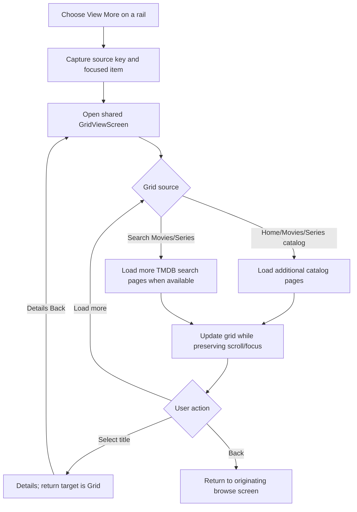

Home rails and Search View More callbacks both set the shell to `Grid`; the grid retains source, scroll, and focused-item state. See [`GridViewScreen.kt`](../app/src/main/java/com/saab/tv/ui/home/GridViewScreen.kt) and the route callbacks in [`MainActivity.kt`](../app/src/main/java/com/saab/tv/MainActivity.kt#L1372).

## 10. Title details

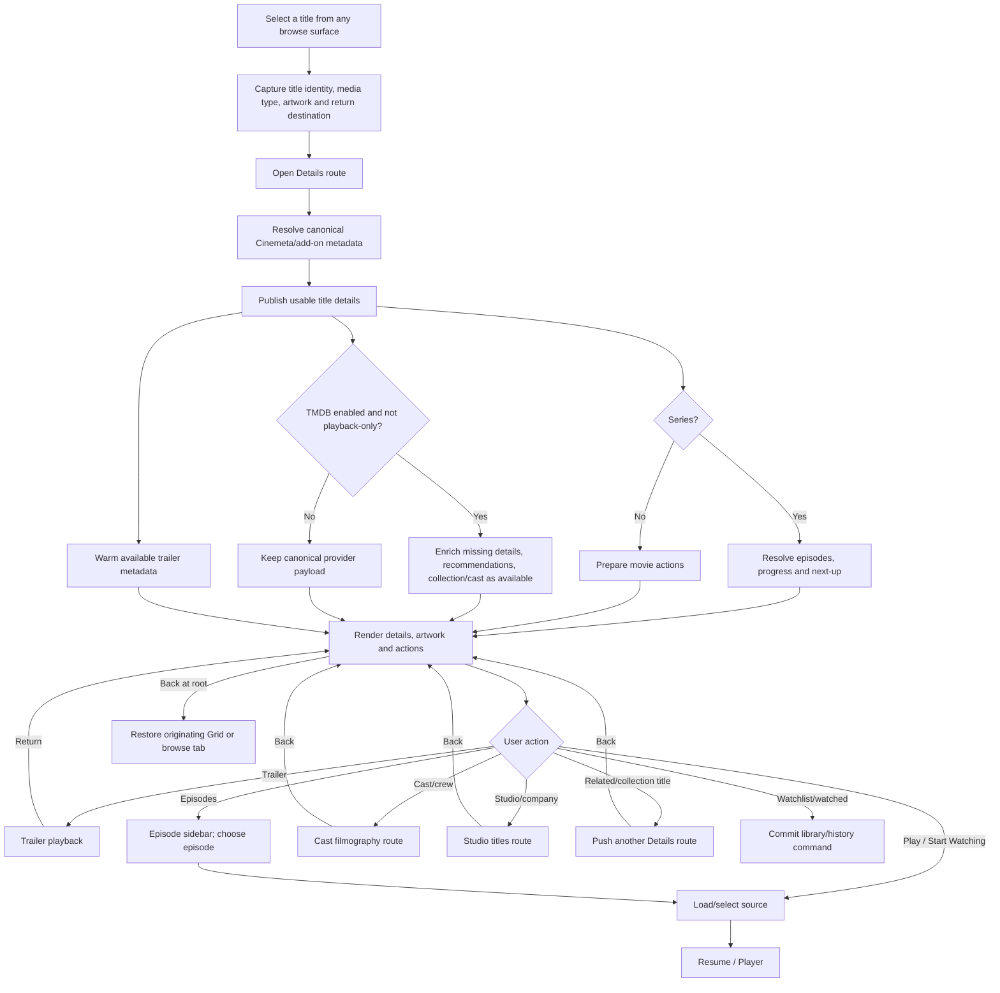

Details first resolves the selected title and publishes its canonical provider data; TMDB enrichment and trailer lookup proceed independently. For standard IMDb movie IDs Cinemeta is tried first; series details/episode numbering use Cinemeta, with add-on fallback for other metadata cases. TMDB may add missing enrichment and recommendations but does not need to block first usable details. See [`DetailsScreen.kt`](../app/src/main/java/com/saab/tv/ui/details/DetailsScreen.kt#L163), [`DetailsViewModel.kt`](../app/src/main/java/com/saab/tv/ui/details/DetailsViewModel.kt#L218), and [`AddonRepository.kt`](../app/src/main/java/com/saab/tv/data/repository/AddonRepository.kt#L758).

## 11. Cast / crew filmography

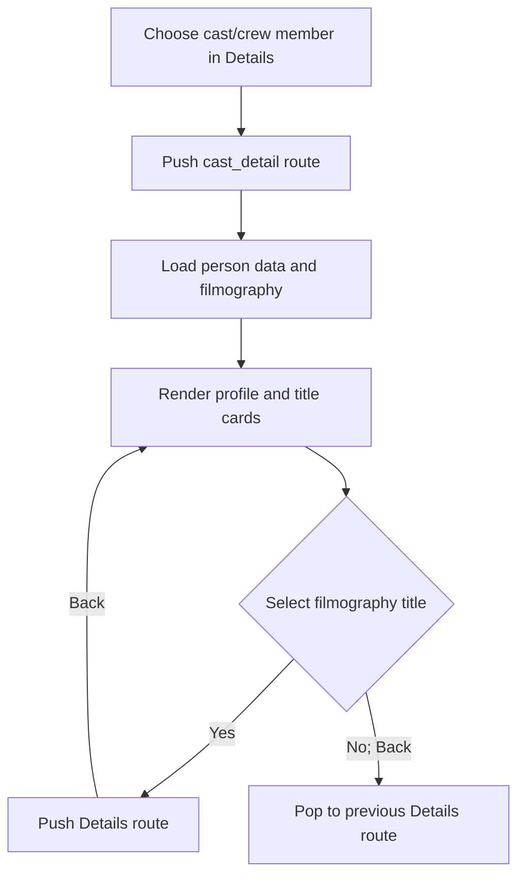

The cast route is nested under the Details `NavHost`; it does not replace the outer browse destination. See [`CastDetailScreen.kt`](../app/src/main/java/com/saab/tv/ui/cast/CastDetailScreen.kt#L88) and route registration in [`MainActivity.kt`](../app/src/main/java/com/saab/tv/MainActivity.kt#L1697).

## 12. Studio / company titles

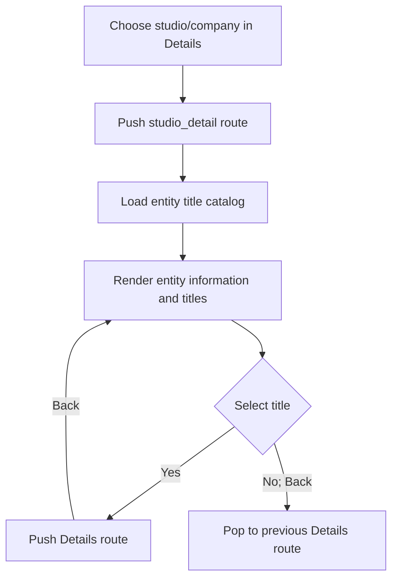

This is another nested Details route and uses its own entity kind/source type. See [`StudioDetailScreen.kt`](../app/src/main/java/com/saab/tv/ui/studio/StudioDetailScreen.kt#L94) and [`MainActivity.kt`](../app/src/main/java/com/saab/tv/MainActivity.kt#L1718).

## 13. Resume and playback

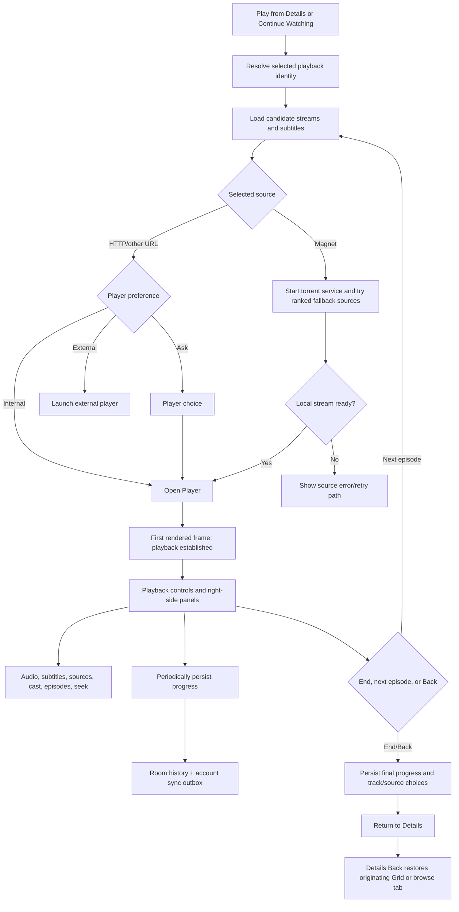

The details play callback constructs the exact selected title/source context before entering `Resume` or `Player`. Playback persists progress locally and requests account sync; seeking, stream selection, cast and track panels are owned by [`PlayerScreen.kt`](../app/src/main/java/com/saab/tv/ui/player/PlayerScreen.kt#L67) and [`PlayerViewModel.kt`](../app/src/main/java/com/saab/tv/ui/player/PlayerViewModel.kt#L40). The shell callback returns to Details after playback session state is committed in [`MainActivity.kt`](../app/src/main/java/com/saab/tv/MainActivity.kt#L2543).

## 14. Settings overview and subsections

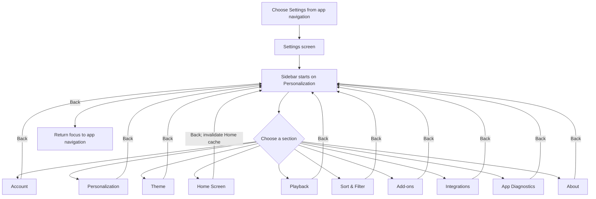

The settings sidebar and right-hand pane are a single screen with section-specific content. D-pad selection changes the displayed subsection; moving focus right enters its first available control. Back from a control returns to the selected section; Back from the sidebar returns focus to app navigation. Implemented sections are enumerated in [`SettingsScreen.kt`](../app/src/main/java/com/saab/tv/ui/settings/SettingsScreen.kt#L59).

### Account settings

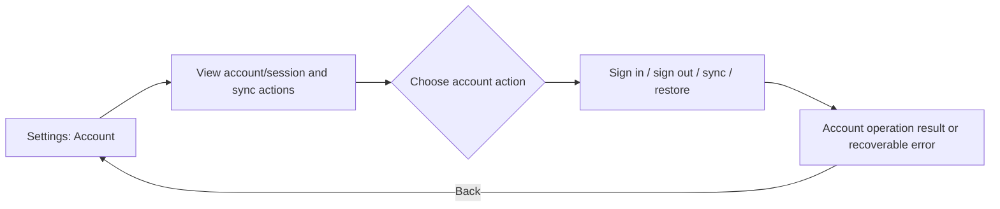

Screen: [`AccountSettingsScreen.kt`](../app/src/main/java/com/saab/tv/ui/account/AccountSettingsScreen.kt#L65).

### Personalization settings

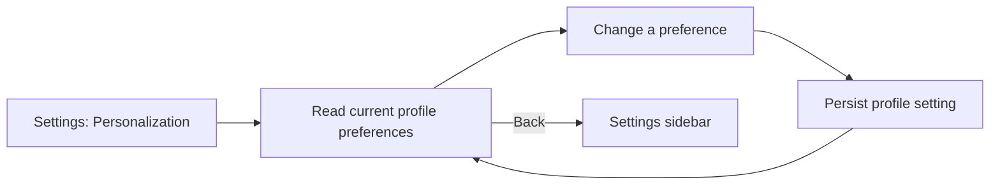

Includes profile-level viewing and title-card choices; screen: [`SettingsSubScreens.kt`](../app/src/main/java/com/saab/tv/ui/settings/SettingsSubScreens.kt#L147).

### Theme settings

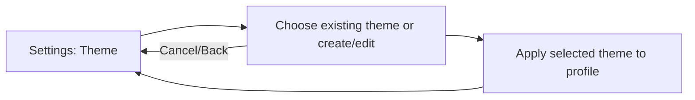

Screen implementation is in [`SettingsSubScreens.kt`](../app/src/main/java/com/saab/tv/ui/settings/SettingsSubScreens.kt) and theme management is provided by `ThemeManager`.

### Home Screen editor

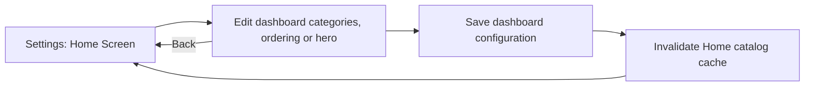

The shell invalidates the Home view model after editor back/save so configuration changes are reflected on re-entry. Screen: [`DashboardEditorScreen.kt`](../app/src/main/java/com/saab/tv/ui/settings/DashboardEditorScreen.kt).

### Playback settings

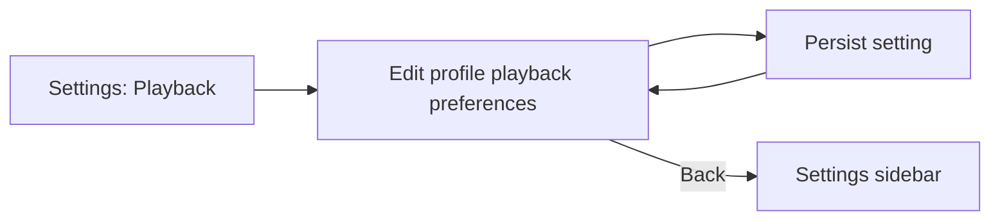

Screen: [`SettingsSubScreens.kt`](../app/src/main/java/com/saab/tv/ui/settings/SettingsSubScreens.kt#L270).

### Sort & Filter settings

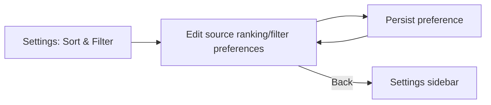

Screen: [`SettingsSubScreens.kt`](../app/src/main/java/com/saab/tv/ui/settings/SettingsSubScreens.kt#L1844).

### Add-ons

```mermaid
flowchart LR
    A[Settings: Add-ons] --> B[Browse installed add-ons]
    B --> C{Install, configure, update or remove}
    C --> D[Apply add-on change]
    D --> B
    B -->|Back| A0[Settings sidebar]
```

Screen: [`AddonsScreen.kt`](../app/src/main/java/com/saab/tv/ui/addons/AddonsScreen.kt#L64).

### Integrations

```mermaid
flowchart LR
    A[Settings: Integrations] --> B[Choose integration]
    B --> C[Configure credentials/options]
    C --> D[Validate or save integration]
    D --> B
    B -->|Back| A0[Settings sidebar]
```

Screen: [`IntegrationsScreen.kt`](../app/src/main/java/com/saab/tv/ui/settings/IntegrationsScreen.kt#L67).

### App Diagnostics

```mermaid
flowchart LR
    A[Settings: App Diagnostics] --> B[Inspect application and playback events]
    B --> C[Scroll, filter or export/share diagnostics]
    C --> B
    B -->|Back| A0[Settings sidebar]
```

Screen: [`PlaybackDiagnosticsSettings.kt`](../app/src/main/java/com/saab/tv/ui/settings/PlaybackDiagnosticsSettings.kt#L73).

### About / update

```mermaid
flowchart LR
    A[Settings: About] --> B[View app/build information]
    B --> C[Check for update or open available app action]
    C --> D[Show update state/result]
    D --> B
    B -->|Back| A0[Settings sidebar]
```

Screen: [`SettingsSubScreens.kt`](../app/src/main/java/com/saab/tv/ui/settings/SettingsSubScreens.kt#L2166).

## 15. Account and cloud sync

```mermaid
flowchart TD
    A[Account state change or user-state command] --> B[Commit local Room transaction]
    B --> C[Append/update sync outbox and revision]
    C --> D{Signed in, unlocked and network available?}
    D -- No --> E[Keep local state; retry when eligible]
    D -- Yes --> F[AccountSyncManager schedules sync]
    F --> G[Push pending commands/snapshot]
    G --> H[Pull remote account state]
    H --> I[Reconcile remote state into local Room]
    I --> J[Room flows refresh screens]
    E -->|Eligibility changes / retry| F
```

User-state changes are written locally first; cloud sync is an asynchronous follow-up and does not own the visible screen state. The command boundary is [`UserStateCommandRepository.kt`](../app/src/main/java/com/saab/tv/data/account/UserStateCommandRepository.kt#L23); sync orchestration is [`AccountSyncManager.kt`](../app/src/main/java/com/saab/tv/data/account/AccountSyncManager.kt#L230). Trakt synchronization is a separate integration path.

## 16. Title-card actions and user-state updates

```mermaid
flowchart TD
    A[Focus title card] --> B[Show canonical artwork and available badges]
    B --> C{Select, long-press or preview action}
    C -- Select --> D[Open title Details]
    C -- Long-press --> E[Quick-action popup]
    E --> F{Choose action}
    F -- Add/remove watchlist --> G[Toggle library command]
    F -- Mark/unmark watched --> H[Update history/series next-up]
    G --> I[Commit Room + sync outbox]
    H --> I
    I --> J[Room flow updates badge/Library immediately]
    C -- Trailer preview --> K[Inline trailer]
    K -->|Start Watching| L[Use the focused card's playback identity]
    L --> M[Resume / source selection / Player]
```

The card UI is shared across browse, Search, Details-related rows, filmography, and Library. Mutations use the shared user-state command boundary; Room updates are local-first and the outbox is synchronized afterward. See [`HomeViewModel.kt`](../app/src/main/java/com/saab/tv/ui/home/HomeViewModel.kt#L249), [`DetailsViewModel.kt`](../app/src/main/java/com/saab/tv/ui/details/DetailsViewModel.kt#L760), and [`UserStateCommandRepository.kt`](../app/src/main/java/com/saab/tv/data/account/UserStateCommandRepository.kt#L23).

## Metadata and ownership quick map

| Concern | Current owner / behavior |
|---|---|
| Shell routes and browse return | `MainActivity` + `ShellView` / `BrowseReturnPolicy` |
| Home, Movies, Series | Shared `HomeScreen` + `HomeViewModel`, configured per tab/profile |
| OTT | `OttCatalogRepository` + JustWatch client; Cinemeta resolves title metadata |
| Search | `SearchScreen` + `SearchViewModel`; Cinemeta catalog search and optional parallel TMDB discovery |
| Details | `DetailsScreen` + `DetailsViewModel`; canonical provider data first, optional asynchronous TMDB enrichment |
| My Library | `WatchlistScreen` + `WatchlistViewModel`; profile-scoped Room history/watchlist/next-up projection |
| Playback | `PlayerScreen` + `PlayerViewModel`; streams, controls, progress, seek thumbnails and playback panels |
| Canonical metadata | `CanonicalFieldResolver`: identity-verified source priority; localized language is a tie-break within source priority, not a way for TMDB to replace populated higher-priority Cinemeta fields |
| Cloud user state | Local Room transaction/outbox first, then `AccountSyncManager` push/pull/reconciliation |

The canonical field authority is implemented in [`CanonicalFieldResolver.kt`](../app/src/main/java/com/saab/tv/domain/schema/CanonicalFieldResolver.kt#L10). The current priority for localized title/synopsis fields is user override (where supported), Cinemeta, TMDB, add-on, then legacy; for an already-present Cinemeta value, a language preference does not promote TMDB above it.

## Browse return and focus rules

| Situation | Current route/focus behavior |
|---|---|
| Enter a browse destination | Shell selects a destination-specific entry requester; Home/Movies/Series/OTT share the catalog entry target |
| Open title from a browse tab | Save title selection and `previousView`; open Details |
| Open title from View More grid | Save `Grid` as return target; Details Back returns to Grid |
| Back from nested cast/studio/related details | Pop the nested Details `NavHost` route |
| Back from root Details | Return to Grid if origin was Grid; otherwise return to the selected browse screen |
| Back from Player | Persist session state and return to Details; the next Back returns to originating browse/grid |
| Search Back | If a result is focused, first return to Search entry; otherwise hand focus to app navigation |
| My Library Details return | Restore the remembered section/card; if unavailable, use the first available title |
| Settings Back | Content controls return focus to selected subsection; subsection sidebar returns focus to app navigation |

The concrete root-details return decision is [`BrowseReturnPolicy.kt`](../app/src/main/java/com/saab/tv/ui/navigation/BrowseReturnPolicy.kt#L6), while the caller and focus token are in [`MainActivity.kt`](../app/src/main/java/com/saab/tv/MainActivity.kt#L1495). Search and Library have screen-specific Back/focus handlers.
